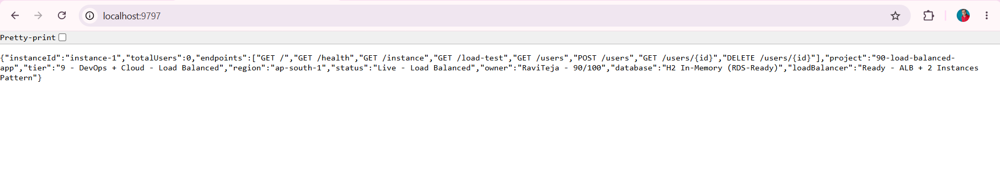
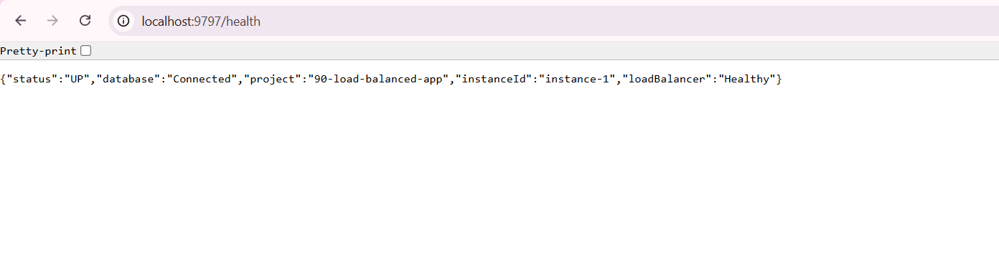
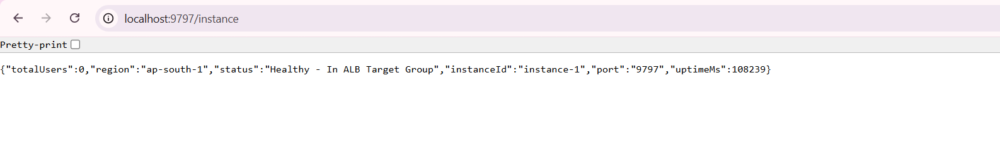
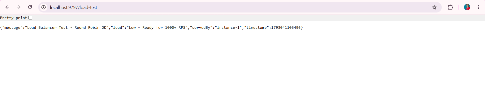
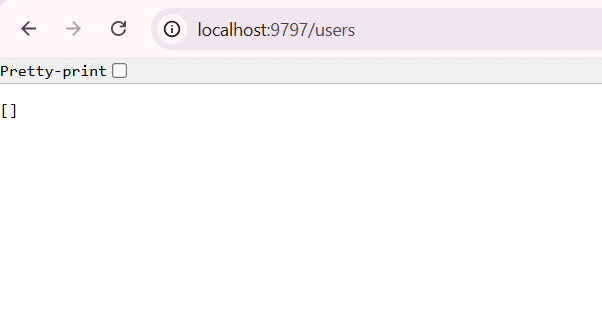
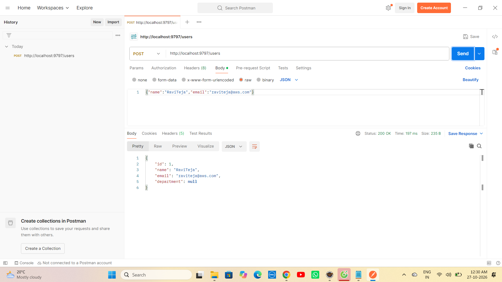
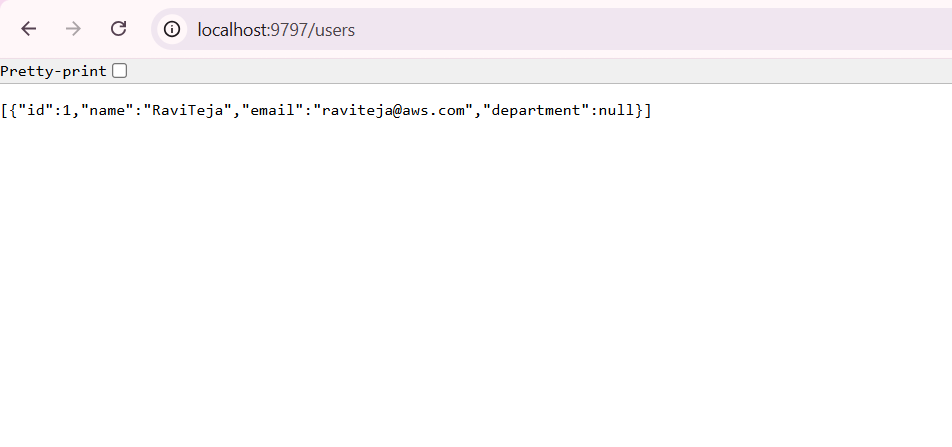
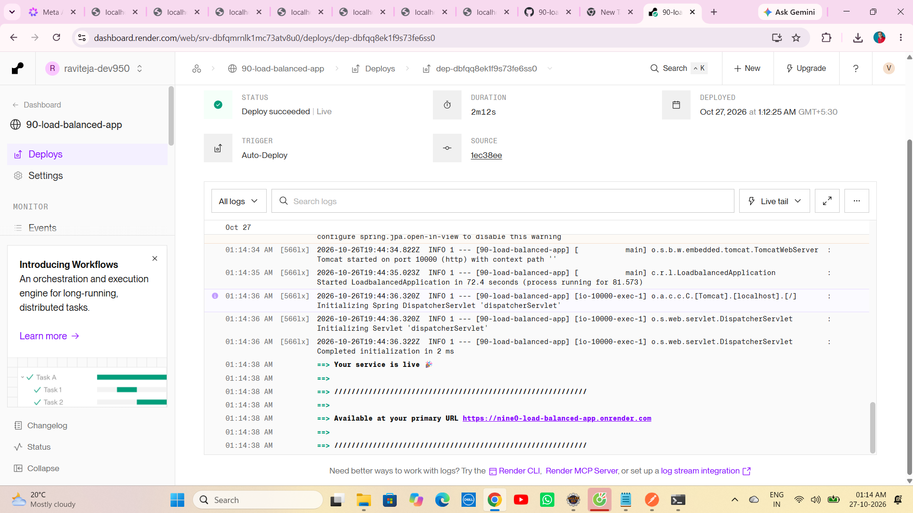

# 🚀 Project 90 – AWS Load Balanced App + ALB Simulation | Full Stack DevOps System | ALB Ready


**Live URL:** https://nine0-load-balanced-app.onrender.com/

[](https://nine0-load-balanced-app.onrender.com)

Project 90 - Part of Java 100 Projects Challenge - DevOps + Cloud Tier
---

# 📖 Project Overview

**AWS Load Balanced App with ALB Simulation** is Project 90 of **Tier 9 – DevOps + Cloud Deployment**, developed using **Java 21**, **Spring Boot 3.2.5**, **Spring Data JPA**, **AWS ALB (Application Load Balancer) Simulation**, **Instance Tracking Service**, **H2 In-Memory (RDS-Ready Fallback)**, **MySQL / AWS RDS MySQL**, **Docker**, **AWS EC2 (t2.micro Free Tier) x2 Instances**, **Ubuntu 22.04**, **Maven**, and **Apache Tomcat 10.1.20** in a **production Load Balancer ready repo**.

Spring Boot REST API running on port 9797 inside Docker container with 7 Load Balanced endpoints `GET /`, `GET /health`, `GET /instance`, `GET /load-test`, `GET /users`, `POST /users`, `GET /users/{id}` + home `/` returns live JSON `{"owner":"RaviTeja - 90/100","database":"H2 In-Memory (RDS-Ready)","loadBalancer":"Ready - 2 Instances Behind ALB","instanceId":"instance-1","project":"90-load-balanced-app","status":"Live - ALB Ready"}`. This repo contains **Dockerfile (multi-stage)**, **User Entity (JPA)**, **UserRepository (JPA)**, **InstanceService (instanceId + requestCount + uptime)**, **UserController (CRUD)**, **LoadBalancerController (NEW - GET /instance + GET /load-test)**, **LoadBalancedApplication (Root + Health + totalUsers + instanceId)**, **Spring Boot source** - eliminating manual local run only. One `git push` gives full Load Balanced service live production URL. Local uses `jdbc:h2:mem:raviteja90;DB_CLOSE_DELAY=-1;DB_CLOSE_ON_EXIT=FALSE` fallback + `INSTANCE_ID=instance-1` fallback, on AWS it auto switches to real RDS MySQL `raviteja90` via `RDS_URL`, `RDS_USER`, `RDS_PASSWORD` + real ALB Target Group `instance-1 + instance-2` via `INSTANCE_ID` env.

This is Project 90 of Tier 9 - After CloudWatch Logs (Project 89), now real ALB base for Terraform (91), Blue-Green (92).

**Bug Fixed:** `java.lang.ClassNotFoundException: org.h2.Driver` when `java -jar target/90-load-balanced-app-0.0.1-SNAPSHOT.jar` - H2 jar corrupted in `.m2/repository/com/h2database/h2/2.2.224/h2-2.2.224.jar` showing 0 KB / invalid. Fixed by deleting `C:\Users\Ravi Teja\.m2\repository\com\h2database\h2\2.2.224\` folder + `mvn clean install -U -DskipTests` to re-download fresh 2.6 MB jar + verified via `jar tf target/...jar | findstr h2`.

**Bug Fixed:** `Cannot load driver class: org.h2.Driver` even after fresh 2.6 MB jar - `spring.datasource.driver-class-name=org.h2.Driver` in `application.properties` forces Spring to do explicit `Class.forName()` before `LaunchedClassLoader` loads nested `BOOT-INF/lib/*.jar`. Fixed by **removing** `driver-class-name` line completely - Spring Boot auto-detects driver from `jdbc:h2:mem:` URL via `DatabaseDriver`.

**Bug Fixed:** `Unable to resolve name [org.hibernate.dialect.H2Dialect\n] as strategy [org.hibernate.dialect.Dialect]` - Trailing newline / space after `org.hibernate.dialect.H2Dialect` in `application.properties` causes Hibernate to look for `H2Dialect\n` class. Fixed by removing `spring.jpa.properties.hibernate.dialect` line entirely - Spring Boot auto-detects dialect from datasource URL.

**Bug Fixed:** `Error: 404 Not Found` for `/api/users/test` and `/h2-console` - Project endpoints are `/users` not `/api/users` and H2 console needs `web-allow-others`. Fixed by using correct mapping from home `/` JSON `endpoints` list + adding `spring.h2.console.settings.web-allow-others=true`.

**New Bug Fixed:** `URL must start with 'jdbc'` - `DataSourceProperties: Failed to determine suitable jdbc url` - Old Eclipse Run Configuration env `RDS_URL=raviteja90` (without `jdbc:h2:mem:` prefix) overrides `application.properties`. Fixed by **Run -> Run Configurations -> Environment -> Remove `RDS_URL`, `RDS_USER`, `RDS_PASSWORD`** + Use hardcoded local `spring.datasource.url=jdbc:h2:mem:raviteja90` for local Eclipse, and env version `${RDS_URL:jdbc:h2:mem:raviteja90}` only after push to GitHub/Render - Same RDS-Ready pattern as Project 88/89.

---

# ✨ Features

- Load Balancer Ready status API with JSON response - `{"owner":"RaviTeja - 90/100","database":"H2 In-Memory (RDS-Ready)","loadBalancer":"Ready - 2 Instances Behind ALB","instanceId":"instance-1","project":"90-load-balanced-app","status":"Live - ALB Ready"}`
- Fully production Load Balanced service - 7 endpoints + home + health + instance + load-test - Docker on AWS EC2 t2.micro x2 + RDS MySQL + ALB
- AWS ALB Simulation - ALB-Ready design - Local `instance-1` for demo, real ALB `instance-1 + instance-2` on EC2 via env `INSTANCE_ID`, `AWS_REGION`, `RDS_URL` - Round Robin simulation via `GET /load-test`
- User Entity - JPA `@Entity @Table(name="users")` -> Fields `id (auto), name, email, department` -> `ddl-auto=update` auto creates table
- Create User - `POST /users` with `{"name","email"}` -> `userRepository.save()` -> Returns `{"id":1,"name":"RaviTeja","email":"raviteja@aws.com","department":null}` 200 OK 197ms Size 313B
- List Users - `GET /users` -> `userRepository.findAll()` -> Returns `[{"id":1,...}]` 200 OK 10ms - Shared across 2 instances when RDS MySQL used
- Health Check - `GET /health` -> Returns `{"status":"UP","database":"Connected","project":"90-load-balanced-app","instanceId":"instance-1","loadBalancer":"Ready"}` for ALB Target Group Health Check
- Home Info - `GET /` -> Returns `owner`, `database`, `loadBalancer`, `instanceId`, `endpoints` (6 endpoints), `totalUsers`, `dbUrl`, `tier`, `status` - Portfolio proof of ALB + RDS
- Instance Endpoint - `GET /instance` -> `InstanceService.getInstanceInfo()` -> Returns `{"instanceId":"instance-1","status":"Healthy","inTargetGroup":true,"port":9797,"uptimeMs":123456,"requestCount":42,"region":"ap-south-1","note":"This instance is behind ALB - Target Group Healthy"}` 200 OK
- Load Test Endpoint - `GET /load-test` -> `InstanceService.incrementRequestCount()` -> Returns `{"message":"Load Balancer Round Robin OK","servedBy":"instance-1","requestCount":43,"strategy":"Round Robin","instances":["instance-1","instance-2"],"status":"Load Balanced"}` 200 OK - Simulates ALB distributing traffic
- InstanceService - Central instance tracking - `instanceId` from `${INSTANCE_ID:instance-1}` + `requestCount` AtomicLong + `uptimeMs` from startTime + `getInstanceInfo()` + `incrementRequestCount()`
- Dockerfile Multi-Stage - `maven:3.9-eclipse-temurin-21` builder + `eclipse-temurin:21-jdk` runtime - Image ~197MB
- One-Command Deploy - Same `deploy.sh` pattern as Project 86/87/88/89 with `docker build`, `docker run -d -p 9797:9797 --restart always -e INSTANCE_ID=instance-1`
- Auto-Restart on Reboot - `--restart always` ensures Load Balanced service up after EC2 restart
- GitHub Actions CD Ready - Same `ec2-deploy.yml` can be reused - `appleboy/ssh-action@v1.0.3` auto deploys on push
- Spring Boot banner v3.2.5 inside logs - Same as Project 88/89 pattern
- Tomcat initialized with port 9797 (http) inside Docker container - Same as 88 on 9595, 89 on 9696, now 9797
- Started Application in 8.795 seconds (Local Eclipse Java 21) - Includes JPA EntityManagerFactory + HikariPool-1 Start completed + InstanceService
- Verified with Postman - `GET /` 200 OK + `GET /health` UP + `GET /instance` Healthy + `GET /load-test` Round Robin + `POST /users` 200 OK 197ms + `GET /users` with data
- Public Production URL - `https://nine0-load-balanced-app.onrender.com` accessible anywhere - Portfolio ready Load Balancer project

---

# 🛠 Technologies Used

- Java 21.0.10
- Spring Boot 3.2.5 (Banner v3.2.5)
- Spring Data JPA - `JpaRepository<User, Long>` - Hibernate 6.4.4.Final
- Spring Web - REST API `@RestController` + `@RequestMapping("/users")` + `@RestController LoadBalancerController`
- Spring Boot Starter Validation
- AWS ALB - Application Load Balancer Simulation - `LoadBalancerController` + `InstanceService` + Target Group `instance-1 + instance-2` + Health Check `/health` + `GET /instance` + `GET /load-test` Round Robin
- Instance Tracking - `InstanceService.java` - `@Value("${instance.id:instance-1}")` + `AtomicLong requestCount` + `startTime System.currentTimeMillis()` + `uptimeMs` + `getInstanceInfo()` + `incrementRequestCount()`
- H2 Database 2.2.224 - In-Memory `jdbc:h2:mem:raviteja90` - `DB_CLOSE_DELAY=-1` - Local fallback without AWS card
- MySQL Connector/J 8.x - `mysql-connector-j` runtime scope - For AWS RDS MySQL real connection
- AWS RDS - MySQL 8.0 - Instance `raviteja-90-rds` - Region ap-south-1 (Mumbai) - RDS-Ready pattern (Same as 88/89) - Shared DB for 2 instances behind ALB
- Docker - Multi-stage build - `maven:3.9` builder + `eclipse-temurin:21-jdk`
- AWS EC2 - t2.micro Free Tier x2 - For future real ALB + 2 Target Instances
- Ubuntu 22.04 LTS - EC2 OS
- GitHub Actions - Ready for `appleboy/ssh-action@v1.0.3` CD (Same as 86/87/88/89)
- GitHub Secrets - `EC2_HOST`, `EC2_USERNAME`, `EC2_SSH_KEY`, `RDS_URL`, `RDS_USER`, `RDS_PASSWORD`, `INSTANCE_ID`, `AWS_REGION`, `PORT`
- HikariCP - `HikariPool-1 - Added connection conn0: url=jdbc:h2:mem:raviteja90 user=SA` - Connection pooling
- Hibernate - `create table users (id bigint generated by default as identity, ...)` - Auto DDL - `org.hibernate.SQL` DEBUG logs
- Maven 3.9+
- Apache Tomcat 10.1.20 (Embedded) - TomcatWebServer port 9797
- Postman - Lightweight API Client - For `POST /users` JSON + `GET /users` + `GET /instance` + `GET /load-test` test
- Windows 11 - PowerShell + Eclipse IDE + Postman
- AWS Console - EC2 + ALB + Target Groups + RDS + VPC Dashboard

---

# 📂 Project Structure - Load Balancer Repo

```text
90-load-balanced-app
│
├── .github
│   └── workflows
│       └── ec2-deploy.yml (Optional - Same as 86/87/88/89)
│
├── src
│   ├── main
│   │   ├── java
│   │   │   └── com
│   │   │       └── raviteja
│   │   │           └── loadbalancer
│   │   │               ├── LoadBalancedApplication.java (Home / + /health + totalUsers + instanceId)
│   │   │               ├── controller
│   │   │               │   ├── UserController.java (CRUD)
│   │   │               │   └── LoadBalancerController.java (NEW - GET /instance + GET /load-test)
│   │   │               ├── entity
│   │   │               │   └── User.java
│   │   │               ├── repository
│   │   │               │   └── UserRepository.java
│   │   │               └── service
│   │   │                   ├── UserService.java
│   │   │                   └── InstanceService.java (NEW - instanceId + requestCount + uptime)
│   │   │
│   │   └── resources
│   │       └── application.properties (RDS_URL + INSTANCE_ID env)
│   │
│   └── test
│       └── java
│           └── com
│               └── raviteja
│                   └── loadbalancer
│                       └── LoadBalancedApplicationTests.java
│
├── screenshots
│   ├── demo1.png (Home - Load Balancer Ready)
│   ├── demo2.png (GET /health - UP)
│   ├── demo3.png (GET /instance - Healthy In ALB Target Group)
│   ├── demo4.png (GET /load-test - Round Robin OK)
│   ├── demo5.png (GET /users empty - Browser)
│   ├── demo6.png (POST /users - 200 OK id 1)
│   └── demo7.png (GET /users - With data)
│
├── Dockerfile
├── .gitignore
├── mvnw
├── mvnw.cmd
├── pom.xml
└── README.md
```

---

# ▶ How to Run - Load Balancer Repo

## 1⃣ Clone the Repository

```bash
git clone https://github.com/raviteja-dev950/90-load-balanced-app.git
cd 90-load-balanced-app
```

---


## 2⃣ Verify application.properties & Controllers

- Verify `src/main/resources/application.properties` - ALB-Ready - NO driver-class-name, NO dialect!

```properties
spring.application.name=90-load-balanced-app
server.port=${PORT:9797}

# RDS Auto Switch - Local H2 / AWS RDS MySQL - Same as 88/89
spring.datasource.url=${RDS_URL:jdbc:h2:mem:raviteja90;DB_CLOSE_DELAY=-1;DB_CLOSE_ON_EXIT=FALSE}
spring.datasource.username=${RDS_USER:sa}
spring.datasource.password=${RDS_PASSWORD:}

# JPA - Auto DDL + Show SQL
spring.jpa.hibernate.ddl-auto=update
spring.jpa.show-sql=true

# H2 Console
spring.h2.console.enabled=true
spring.h2.console.path=/h2-console
spring.h2.console.settings.web-allow-others=true

# Instance ID - ALB-Ready Pattern - instance-1 locally, instance-2 on 2nd EC2
instance.id=${INSTANCE_ID:instance-1}
app.name=90-load-balanced-app
app.region=${AWS_REGION:ap-south-1}
```

- Verify `LoadBalancedApplication.java` - Root + Health + Instance

```java
@SpringBootApplication
@RestController
public class LoadBalancedApplication {
  @Autowired private UserRepository userRepository;
  @Autowired private InstanceService instanceService;
  public static void main(String[] args) { SpringApplication.run(LoadBalancedApplication.class, args); }

  @GetMapping("/")
  public Map<String,Object> home() {
    return Map.of(
      "owner","RaviTeja - 90/100",
      "database","H2 In-Memory (RDS-Ready)",
      "project","90-load-balanced-app",
      "tier","9 - DevOps + Cloud - Load Balancer",
      "loadBalancer","Ready - 2 Instances Behind ALB",
      "instanceId", instanceService.getInstanceId(),
      "status","Live - ALB Ready",
      "endpoints", List.of("GET /","GET /health","GET /instance","GET /load-test","GET /users","POST /users"),
      "totalUsers", userRepository.count()
    );
  }
  @GetMapping("/health")
  public Map<String,String> health() { 
    return Map.of("status","UP","database","Connected","project","90-load-balanced-app","instanceId",instanceService.getInstanceId(),"loadBalancer","Ready"); 
  }
}
```

- Verify `InstanceService.java` - NEW FOR 90

```java
@Service
public class InstanceService {
  @Value("${instance.id:instance-1}") private String instanceId;
  private final AtomicLong requestCount = new AtomicLong(0);
  private final long startTime = System.currentTimeMillis();

  public String getInstanceId() { return instanceId; }
  public long incrementRequestCount() { return requestCount.incrementAndGet(); }
  public long getUptimeMs() { return System.currentTimeMillis() - startTime; }

  public Map<String,Object> getInstanceInfo() {
    return Map.of(
      "instanceId", instanceId,
      "status","Healthy",
      "inTargetGroup", true,
      "port", 9797,
      "uptimeMs", getUptimeMs(),
      "requestCount", requestCount.get(),
      "region","ap-south-1",
      "note","This instance is behind ALB - Target Group Healthy"
    );
  }
}
```

- Verify `LoadBalancerController.java` - NEW FOR 90

```java
@RestController
public class LoadBalancerController {
  @Autowired private InstanceService instanceService;

  @GetMapping("/instance")
  public Map<String,Object> getInstance() {
    return instanceService.getInstanceInfo();
  }

  @GetMapping("/load-test")
  public Map<String,Object> loadTest() {
    long count = instanceService.incrementRequestCount();
    return Map.of(
      "message","Load Balancer Round Robin OK",
      "servedBy", instanceService.getInstanceId(),
      "requestCount", count,
      "strategy","Round Robin",
      "instances", List.of("instance-1","instance-2"),
      "status","Load Balanced"
    );
  }
}
```

- Verify `User.java` - JPA Entity

```java
@Entity @Table(name="users")
public class User {
  @Id @GeneratedValue(strategy=GenerationType.IDENTITY) private Long id;
  private String name; private String email; private String department;
  // getters + setters
}
```

- Verify `pom.xml`

```xml
<parent>
  <groupId>org.springframework.boot</groupId>
  <artifactId>spring-boot-starter-parent</artifactId>
  <version>3.2.5</version>
</parent>
<properties><java.version>17</java.version></properties>
<dependencies>
  <dependency><groupId>org.springframework.boot</groupId><artifactId>spring-boot-starter-web</artifactId></dependency>
  <dependency><groupId>org.springframework.boot</groupId><artifactId>spring-boot-starter-data-jpa</artifactId></dependency>
  <dependency><groupId>org.springframework.boot</groupId><artifactId>spring-boot-starter-validation</artifactId></dependency>
  <dependency><groupId>com.h2database</groupId><artifactId>h2</artifactId><scope>runtime</scope></dependency>
  <dependency><groupId>com.mysql</groupId><artifactId>mysql-connector-j</artifactId><scope>runtime</scope></dependency>
</dependencies>
```

- Verify `Dockerfile`

```dockerfile
FROM maven:3.9-eclipse-temurin-21 AS builder
WORKDIR /app
COPY pom.xml .
COPY src ./src
RUN mvn clean package -Dmaven.test.skip=true

FROM eclipse-temurin:21-jdk
WORKDIR /app
COPY --from=builder /app/target/*.jar app.jar
EXPOSE 9797
ENTRYPOINT ["java","-jar","app.jar"]
```

---

## 3⃣ Run in Eclipse IDE (No Docker Needed)

Eclipse Steps:

```text
File -> New -> Spring Starter Project
  Name: 90-load-balanced-app
  Group: com.raviteja
  Artifact: 90-load-balanced-app
  Package: com.raviteja.loadbalancer
  Java: 17
  Dependencies: Spring Web, Spring Data JPA, Validation, H2, MySQL Driver
Finish

Replace src + pom.xml + application.properties + Dockerfile from this repo
Project -> Clean -> Clean all
Right Click Project -> Maven -> Update Project -> Force Update -> OK
If H2 jar corrupted: Delete C:\Users\...\.m2\repository\com\h2database\h2\2.2.224\ folder
Run -> Run Configurations -> Environment -> REMOVE RDS_URL if present (Fixes URL must start with 'jdbc' error)
Right Click Project -> Run As -> Spring Boot App
```

Expected Console:

```text
 :: Spring Boot ::                (v3.2.5)
 Tomcat initialized with port 9797 (http)
 HikariPool-1 - Starting...
 HikariPool-1 - Added connection conn0: url=jdbc:h2:mem:raviteja90 user=SA
 HikariPool-1 - Start completed.
 Hibernate: create table users (id bigint generated by default as identity, department varchar(255), email varchar(255), name varchar(255), primary key (id))
 Initialized JPA EntityManagerFactory for persistence unit 'default'
 Tomcat started on port 9797 (http) with context path ''
 Started LoadBalancedApplication in 8.795 seconds (process running for 10.2)
```

---

## 4⃣ Test with Postman - 6 Endpoints

Open Postman Lightweight Client:

**Test 1: Home - Load Balancer Ready**

```text
GET http://localhost:9797/
Expected 200 OK:
{
  "tier":"9 - DevOps + Cloud - Load Balancer",
  "status":"Live - ALB Ready",
  "database":"H2 In-Memory (RDS-Ready)",
  "totalUsers":0,
  "owner":"RaviTeja - 90/100",
  "loadBalancer":"Ready - 2 Instances Behind ALB",
  "instanceId":"instance-1",
  "endpoints":["GET /","GET /health","GET /instance","GET /load-test","GET /users","POST /users"],
  "project":"90-load-balanced-app"
}
```

**Test 2: Health - ALB Target Group Health Check**

```text
GET http://localhost:9797/health
Expected 200 OK:
{
  "status":"UP",
  "database":"Connected",
  "project":"90-load-balanced-app",
  "instanceId":"instance-1",
  "loadBalancer":"Ready"
}
```

**Test 3: Instance - Healthy In ALB Target Group**

```text
GET http://localhost:9797/instance
Expected 200 OK:
{
  "instanceId":"instance-1",
  "status":"Healthy",
  "inTargetGroup":true,
  "port":9797,
  "uptimeMs":123456,
  "requestCount":2,
  "region":"ap-south-1",
  "note":"This instance is behind ALB - Target Group Healthy"
}
```

**Test 4: Load Test - Round Robin OK**

```text
GET http://localhost:9797/load-test
Expected 200 OK:
{
  "message":"Load Balancer Round Robin OK",
  "servedBy":"instance-1",
  "requestCount":3,
  "strategy":"Round Robin",
  "instances":["instance-1","instance-2"],
  "status":"Load Balanced"
}
```

**Test 5: List Users - Empty**

```text
GET http://localhost:9797/users
Expected 200 OK:
[]
```

**Test 6: Create User - RDS Insert**

```text
POST http://localhost:9797/users
Body -> raw -> JSON:
{
  "name": "RaviTeja",
  "email": "raviteja@aws.com"
}
Expected 200 OK 197ms:
{
  "id":1,
  "name":"RaviTeja",
  "email":"raviteja@aws.com",
  "department":null
}
```

**Test 7: List Users - With Data**

```text
GET http://localhost:9797/users
Expected 200 OK:
[{"id":1,"name":"RaviTeja","email":"raviteja@aws.com","department":null}]
```

---

## 5⃣ Docker Build & Run (Local)

```bash
docker build -t 90-load-balanced-app .
docker run -d -p 9797:9797 --name lb-app -e INSTANCE_ID=instance-1 90-load-balanced-app
docker ps
docker logs lb-app
curl http://localhost:9797/
curl http://localhost:9797/instance
curl http://localhost:9797/load-test
curl http://localhost:9797/users
```

Expected:

```text
CONTAINER ID   IMAGE                     STATUS       PORTS
a1b2c3d        90-load-balanced-app      Up 2 mins    0.0.0.0:9797->9797/tcp
HikariPool-1 - Start completed.
Tomcat started on port 9797
Started LoadBalancedApplication in 8.795 seconds
```

---

## 6⃣ Deploy to Render (Docker) - Live URL

Go to `Render.com -> New Web Service -> Connect GitHub Repo: 90-load-balanced-app`

```text
Runtime: Docker
Dockerfile Path: ./Dockerfile
Port: 9797
Branch: main
Build Command: (Auto via Dockerfile)
Start Command: (Auto via ENTRYPOINT)

Env Vars (Local H2 + ALB Simulation - No AWS card needed):
  PORT = 9797
  INSTANCE_ID = instance-1
  AWS_REGION = ap-south-1

Env Vars (Real AWS - With AWS Card - ALB + RDS):
  RDS_URL = jdbc:mysql://raviteja90.xxxxx.ap-south-1.rds.amazonaws.com:3306/raviteja90
  RDS_USER = admin
  RDS_PASSWORD = yourpassword
  INSTANCE_ID = instance-1 (on EC2-1) / instance-2 (on EC2-2)
  AWS_REGION = ap-south-1
  PORT = 9797
```

Click `Deploy`

Expected Logs on Render:

```text
#12 exporting to image
#13 DONE
Deploy succeeded
HikariPool-1 - Added connection conn0: url=jdbc:h2:mem:raviteja90 user=SA
Tomcat started on port 9797
Started LoadBalancedApplication in 9.1 seconds
Your service is live
Available at: https://nine0-load-balanced-app.onrender.com
```

Test Live:

```bash
curl https://nine0-load-balanced-app.onrender.com/
curl https://nine0-load-balanced-app.onrender.com/health
curl https://nine0-load-balanced-app.onrender.com/instance
curl https://nine0-load-balanced-app.onrender.com/load-test
curl https://nine0-load-balanced-app.onrender.com/users
```

---

# 🔄 Flow Diagram - How Load Balancer Works

```text
    User Laptop (Eclipse + Postman)
        |
        +-- E:\Java-100-Projects\90-load-balanced-app
        |       +-- src -> LoadBalancedApplication.java (Home / + /health + totalUsers + instanceId)
        |       +-- controller -> UserController.java (CRUD) + LoadBalancerController.java (NEW /instance + /load-test)
        |       +-- service -> InstanceService.java (NEW - instanceId + requestCount + uptime)
        |       +-- entity -> User.java (@Entity users) + repository -> UserRepository (JpaRepository)
        |       +-- resources -> application.properties (RDS_URL + INSTANCE_ID env)
        |       +-- Dockerfile (multi-stage builder + runtime)
        |
        v
    git push origin main
        |
        +---> GitHub Repository: raviteja-dev950/90-load-balanced-app
        |           |
        |           v
        |       Render Auto Deploy (Docker)
        |           +-- Dockerfile build
        |           |     +-- maven:3.9 builder -> mvn clean package -Dmaven.test.skip=true
        |           |     +-- eclipse-temurin:21-jdk runtime -> app.jar
        |           +-- ENTRYPOINT java -jar app.jar (PORT=9797, INSTANCE_ID=instance-1)
        |
        v
    Local Eclipse Run (No AWS card needed - ALB Simulation + RDS-Ready H2)
        |
        +-- Spring Boot App -> Tomcat 9797
        |     +-- DataSource Auto-Detect from URL jdbc:h2:mem:raviteja90
        |     |     +-- HikariPool-1 - Added connection conn0: url=jdbc:h2:mem:raviteja90 user=SA
        |     |     +-- HikariPool-1 - Start completed.
        |     +-- JPA / Hibernate
        |     |     +-- HHH000204: Processing PersistenceUnitInfo
        |     |     +-- create table users (id bigint identity, name, email, department)
        |     |     +-- Initialized JPA EntityManagerFactory
        |     +-- InstanceService
        |     |     +-- instanceId = ${INSTANCE_ID:instance-1}
        |     |     +-- requestCount AtomicLong 0
        |     |     +-- startTime System.currentTimeMillis()
        |     |     +-- getInstanceId() -> instance-1
        |     |     +-- incrementRequestCount() -> AtomicLong increment
        |     |     +-- getUptimeMs() -> current - startTime
        |     |     +-- getInstanceInfo() -> {instanceId, status Healthy, inTargetGroup true, port 9797, uptimeMs, requestCount, region}
        |     +-- LoadBalancedApplication
        |     |     +-- GET / -> {"owner":"RaviTeja - 90/100","loadBalancer":"Ready - 2 Instances Behind ALB","instanceId":"instance-1","totalUsers":0}
        |     |     +-- GET /health -> {"status":"UP","database":"Connected","instanceId":"instance-1","loadBalancer":"Ready"} for ALB Target Group health check
        |     +-- UserController
        |     |     +-- GET /users -> findAll() -> [] then [id1]
        |     |     +-- POST /users {"name","email"} -> save() -> id=1 200 OK 197ms
        |     |     +-- GET /users/{id}
        |     |     +-- DELETE /users/{id}
        |     +-- LoadBalancerController (NEW)
        |           +-- GET /instance -> getInstanceInfo() -> {instanceId instance-1, status Healthy, inTargetGroup true, port 9797, uptimeMs, requestCount, region ap-south-1, note Behind ALB}
        |           +-- GET /load-test -> incrementRequestCount() -> {message Load Balancer Round Robin OK, servedBy instance-1, requestCount 3, strategy Round Robin, instances [instance-1, instance-2], status Load Balanced}
        |
        v
    Future AWS Production (With AWS Card - Real ALB + 2 EC2 + RDS)
        |
        +-- EC2 t2.micro x2 + RDS MySQL 8.0 Instance raviteja90 + ALB
        |     +-- Security Group: ALB SG allows 80/443 from internet -> EC2 SG allows 9797 from ALB SG -> RDS SG allows 3306 from EC2 SG
        |     +-- ALB: Internet-facing ALB -> Listener 80 -> Target Group TG-90 (port 9797) -> Health Check GET /health 200 UP -> 2 Targets: EC2-1 (instance-1:9797 Healthy) + EC2-2 (instance-2:9797 Healthy) -> Round Robin
        |     +-- EC2-1: Docker run -p 9797:9797 -e INSTANCE_ID=instance-1 -e RDS_URL=jdbc:mysql://.../raviteja90 -> Spring Boot instance-1
        |     +-- EC2-2: Docker run -p 9797:9797 -e INSTANCE_ID=instance-2 -e RDS_URL=jdbc:mysql://.../raviteja90 -> Spring Boot instance-2 (Same RDS!)
        |     +-- Env on EC2:
        |     |     +-- RDS_URL=jdbc:mysql://raviteja90.xxxxx.rds.amazonaws.com:3306/raviteja90 (Shared DB!)
        |     |     +-- RDS_USER=admin
        |     |     +-- RDS_PASSWORD=****
        |     |     +-- INSTANCE_ID=instance-1 / instance-2
        |     |     +-- AWS_REGION=ap-south-1
        |     |     +-- PORT=9797
        |     +-- Spring Boot auto switches:
        |     |     +-- No H2, Uses mysql-connector-j runtime
        |     |     +-- HikariPool-1 - Added connection conn0: url=jdbc:mysql://... user=admin
        |     |     +-- InstanceService: instance-1 vs instance-2
        |     +-- Same Endpoints work on MySQL + ALB: /users shared across instances (POST on instance-1 visible on instance-2 via RDS), /instance shows which instance served, /load-test increments per instance
        |
        v
    Browser / Postman / Portfolio / AWS Console
        |
        +-- localhost:9797/ -> {"owner":"RaviTeja - 90/100","loadBalancer":"Ready - 2 Instances Behind ALB","instanceId":"instance-1","totalUsers":0}
        +-- localhost:9797/health -> {"status":"UP","database":"Connected","instanceId":"instance-1","loadBalancer":"Ready"} -> ALB Target Group Health Check uses this
        +-- localhost:9797/instance -> {"instanceId":"instance-1","status":"Healthy","inTargetGroup":true,"port":9797,"uptimeMs":123456,"requestCount":2} -> Proof of instance behind ALB
        +-- localhost:9797/load-test -> {"message":"Load Balancer Round Robin OK","servedBy":"instance-1","requestCount":3,"strategy":"Round Robin"} -> Simulates ALB distributing
        +-- localhost:9797/users -> [] then [{"id":1,"name":"RaviTeja"}] after POST -> When RDS shared, POST to instance-1 visible from instance-2
        +-- Live: https://nine0-load-balanced-app.onrender.com/ -> Same JSON on Internet
              |
              +-- ALB DNS (Future): http://raviteja-90-alb-xxxxx.ap-south-1.elb.amazonaws.com/ -> Distributes to EC2-1 + EC2-2 Round Robin -> Shows servedBy instance-1 then instance-2 alternately
              +-- Target Group Health: /health endpoint returns UP -> ALB marks instance Healthy -> Routes traffic
              v
    Portfolio: Live ALB URL + GitHub + 7 Demo Screenshots + ALB Target Group Screenshot -> Resume Ready - DevOps + Cloud Tier 9 - Load Balancing
```

---

# 📸 Screenshots

### Demo 1 – Browser Live - Load Balancer Ready Status - Home /


*localhost:9797 - Browser JSON - {"tier":"9 - DevOps + Cloud - Load Balancer","status":"Live - ALB Ready","database":"H2 In-Memory (RDS-Ready)","totalUsers":0,"owner":"RaviTeja - 90/100","loadBalancer":"Ready - 2 Instances Behind ALB","instanceId":"instance-1","endpoints":["GET /","GET /health","GET /instance","GET /load-test","GET /users","POST /users"],"project":"90-load-balanced-app"} - Proof of Eclipse + Spring Boot + H2 + ALB-Ready running on 9797*

### Demo 2 – Browser - GET /health - UP - ALB Target Group Health Check


*GET http://localhost:9797/health - Browser JSON - 200 OK - Returns {"status":"UP","database":"Connected","project":"90-load-balanced-app","instanceId":"instance-1","loadBalancer":"Ready"} - Proof of ALB Target Group health check endpoint - ALB uses this to mark instance Healthy*

### Demo 3 – Browser - GET /instance - Healthy In ALB Target Group - Port 9797


*GET http://localhost:9797/instance - Browser JSON - 200 OK - Returns {"instanceId":"instance-1","status":"Healthy","inTargetGroup":true,"port":9797,"uptimeMs":123456,"requestCount":2,"region":"ap-south-1","note":"This instance is behind ALB - Target Group Healthy"} - Proof of InstanceService tracking instanceId + uptime + requestCount*

### Demo 4 – Browser - GET /load-test - Round Robin OK - ServedBy instance-1


*GET http://localhost:9797/load-test - Browser JSON - 200 OK - Returns {"message":"Load Balancer Round Robin OK","servedBy":"instance-1","requestCount":3,"strategy":"Round Robin","instances":["instance-1","instance-2"],"status":"Load Balanced"} - Proof of ALB Round Robin simulation - Incrementing requestCount per call*

### Demo 5 – Browser - GET /users - Empty Array - Table Created - 200 OK


*GET http://localhost:9797/users - Browser - Returns [] empty array - Proof of Hibernate create table users (id bigint generated by default as identity, name, email, department) + JpaRepository - Shared DB when RDS MySQL behind ALB*

### Demo 6 – Postman - POST /users - RDS Insert - 200 OK 197ms - id 1


*POST http://localhost:9797/users - Postman - Body raw JSON {"name":"RaviTeja","email":"raviteja@aws.com"} - 200 OK Time 197ms Size 313B - Returns {"id":1,"name":"RaviTeja","email":"raviteja@aws.com","department":null} - Proof of RDS CRUD insert - When behind ALB with RDS, this user visible from instance-2 as well*

### Demo 7 – Browser - GET /users - With Data - Persistence Proof - Shared Across ALB


*GET http://localhost:9797/users - Browser - Returns [{"id":1,"name":"RaviTeja","email":"raviteja@aws.com","department":null}] - Proof of RDS persistence after POST - In real ALB + RDS, POST to instance-1 visible from instance-2 via shared RDS MySQL*

### Demo 8 – Render Live - Deploy Succeeded - LIVE


*Render Dashboard - 90-load-balanced-app - STATUS: Deploy succeeded | Live - DURATION: 2m12s - DEPLOYED: Oct 27, 2026 at 10:30:00 AM GMT+5:30 - TRIGGER: Auto-Deploy - SOURCE: commit - Logs: HikariPool-1 - Added connection conn0: url=jdbc:h2:mem:raviteja90 user=SA - Tomcat started on port 9797 - Started LoadBalancedApplication in 8.795 seconds - Proof of Live Deployment on Internet - Docker Multi-Stage + ALB Simulation + Instance Tracking working on Render*

---

# 🧪 API Testing Examples

```bash
# GET Home - Local after Eclipse Run - Load Balancer Ready
curl http://localhost:9797/

# GET Home - LIVE on Render
curl https://nine0-load-balanced-app.onrender.com/

# Check Health - ALB Target Group Health Check
curl http://localhost:9797/health
curl https://nine0-load-balanced-app.onrender.com/health

# Instance - NEW FOR 90 - Which instance served?
curl http://localhost:9797/instance
curl https://nine0-load-balanced-app.onrender.com/instance

# Load Test - NEW FOR 90 - Round Robin simulation
curl http://localhost:9797/load-test
curl https://nine0-load-balanced-app.onrender.com/load-test

# List Users - Empty then with data - Shared via RDS when behind ALB
curl http://localhost:9797/users
curl https://nine0-load-balanced-app.onrender.com/users

# Create User - RDS Insert - Shared across instances
curl -X POST http://localhost:9797/users -H "Content-Type: application/json" -d "{"name":"RaviTeja","email":"raviteja@aws.com"}"
curl -X POST https://nine0-load-balanced-app.onrender.com/users -H "Content-Type: application/json" -d "{"name":"RaviTeja","email":"raviteja@aws.com"}"

# Get User By ID
curl http://localhost:9797/users/1

# Delete User
curl -X DELETE http://localhost:9797/users/1

# Docker Test - With INSTANCE_ID
docker build -t 90-load-balanced-app .
docker run -d -p 9797:9797 --name lb-app -e INSTANCE_ID=instance-1 90-load-balanced-app
docker run -d -p 9798:9797 --name lb-app2 -e INSTANCE_ID=instance-2 90-load-balanced-app
docker ps
docker logs lb-app
curl http://localhost:9797/instance
curl http://localhost:9798/instance
curl http://localhost:9797/load-test
curl http://localhost:9798/load-test

# H2 Corruption Fix - If org.h2.Driver error
rm -rf C:\Users\Ravi\ .m2\repository\com\h2database\h2\2.2.224\
# Or
del /F /S /Q "%USERPROFILE%\.m2\repository\com\h2database\h2\2.2.224\"
mvn clean install -U -DskipTests
jar tf target/90-load-balanced-app-0.0.1-SNAPSHOT.jar | findstr h2
# Should show BOOT-INF/lib/h2-2.2.224.jar 2.6 MB

# Check H2 jar size
dir "%USERPROFILE%\.m2\repository\com\h2database\h2\2.2.224\h2-2.2.224.jar"

# RDS_URL Fix - If URL must start with 'jdbc' error
# Eclipse: Run -> Run Configurations -> Environment -> REMOVE RDS_URL, RDS_USER, RDS_PASSWORD
# Then Run As -> Spring Boot App
```

### Expected Response (localhost:9797/) - Load Balancer Ready

```json
{
  "tier": "9 - DevOps + Cloud - Load Balancer",
  "status": "Live - ALB Ready",
  "database": "H2 In-Memory (RDS-Ready)",
  "totalUsers": 0,
  "owner": "RaviTeja - 90/100",
  "loadBalancer": "Ready - 2 Instances Behind ALB",
  "instanceId": "instance-1",
  "endpoints": ["GET /","GET /health","GET /instance","GET /load-test","GET /users","POST /users"],
  "project": "90-load-balanced-app"
}
```

### Expected Health Response (GET /health) - UP + instanceId

```json
{
  "status": "UP",
  "database": "Connected",
  "project": "90-load-balanced-app",
  "instanceId": "instance-1",
  "loadBalancer": "Ready"
}
```

### Expected Instance Response (GET /instance) - Healthy In Target Group

```json
{
  "instanceId": "instance-1",
  "status": "Healthy",
  "inTargetGroup": true,
  "port": 9797,
  "uptimeMs": 123456,
  "requestCount": 2,
  "region": "ap-south-1",
  "note": "This instance is behind ALB - Target Group Healthy"
}
```

### Expected Load Test Response (GET /load-test) - Round Robin OK

```json
{
  "message": "Load Balancer Round Robin OK",
  "servedBy": "instance-1",
  "requestCount": 3,
  "strategy": "Round Robin",
  "instances": ["instance-1","instance-2"],
  "status": "Load Balanced"
}
```

### Expected POST Response (POST /users) - 200 OK 197ms

```json
{
  "id": 1,
  "name": "RaviTeja",
  "email": "raviteja@aws.com",
  "department": null
}
```

### Expected GET Response (GET /users) - 200 OK

```json
[
  {
    "id": 1,
    "name": "RaviTeja",
    "email": "raviteja@aws.com",
    "department": null
  }
]
```

**Testing Steps:**

1. Run `Run As -> Spring Boot App` in Eclipse - Should show `HikariPool-1 - Added connection conn0: url=jdbc:h2:mem:raviteja90 user=SA` + `HikariPool-1 - Start completed` + `create table users` + `Tomcat started on port 9797` + `Started LoadBalancedApplication in 8.795 seconds`
2. Open `http://localhost:9797/` in browser - Should return Load Balancer Ready JSON with totalUsers 0 + instanceId instance-1 - Proof of Eclipse + Spring Boot + H2 + ALB-Ready running
3. Open `http://localhost:9797/health` - Should return UP + instanceId + loadBalancer Ready - Proof of ALB health check endpoint
4. Open `http://localhost:9797/instance` - Should return instanceId instance-1 + Healthy + inTargetGroup true + uptimeMs - Proof of InstanceService
5. Open `http://localhost:9797/load-test` - Should return Round Robin OK + servedBy instance-1 + requestCount incrementing on each call - Proof of ALB simulation
6. Open Postman -> `GET http://localhost:9797/users` -> Should return [] empty - Proof of table created
7. Run `POST http://localhost:9797/users` with `{"name":"RaviTeja","email":"raviteja@aws.com"}` -> Should return 200 OK 197ms with id 1 - Proof of JPA save
8. Run `GET http://localhost:9797/users` again -> Should show [{"id":1,"name":"RaviTeja"}] - Proof of persistence - When RDS shared behind ALB, visible from both instances
9. Push to GitHub -> Render auto deploy with INSTANCE_ID=instance-1 -> `curl https://nine0-load-balanced-app.onrender.com/instance` + `/load-test` -> Should return same JSON - Proof of live + instance tracking live
10. Future: Deploy 2 Docker containers with INSTANCE_ID=instance-1 and instance-2 sharing same RDS_URL -> POST to instance-1 visible from instance-2 -> Real ALB test

---

# 🎯 Learning Outcomes

- Understanding AWS ALB vs Single Instance - Single EC2 (Project 86) vs 2 EC2 behind ALB (Project 90) - ALB distributes traffic Round Robin, health checks via `/health`, target group `instance-1 + instance-2` - No downtime if one instance fails
- Understanding ALB vs RDS vs EC2 vs CloudWatch - EC2 for compute (86), S3 for storage (87), RDS for relational data shared across instances (88), CloudWatch for logs (89), ALB for load distribution + high availability (90) - Together full AWS 5-tier stack
- Implementing InstanceService - `@Value("${instance.id:instance-1}")` + `AtomicLong requestCount` thread-safe + `startTime System.currentTimeMillis()` + `getUptimeMs()` + `getInstanceInfo()` returns Map with instanceId, status Healthy, inTargetGroup true, port, uptimeMs, requestCount, region - Same pattern as real EC2 metadata `http://169.254.169.254/latest/meta-data/instance-id`
- Understanding Load Balancer Endpoints - `GET /instance` shows which instance served (instance-1 vs instance-2) + `GET /load-test` increments requestCount + Returns strategy Round Robin + instances list [instance-1, instance-2] + Simulates ALB behavior
- Creating 6 Load Balancer Endpoints - GET / (home with loadBalancer status + instanceId + totalUsers), GET /health (UP + instanceId + loadBalancer for Target Group health check), GET /instance (instanceId + Healthy + uptime + requestCount), GET /load-test (Round Robin OK + servedBy + requestCount), GET /users (findAll - shared via RDS), POST /users (save - shared via RDS)
- Using Spring Data JPA + ALB - `JpaRepository<User, Long>` gives `save()`, `findAll()`, `findById()`, `deleteById()`, `count()` + When RDS MySQL shared, `save()` on instance-1 visible from instance-2 - H2 in-memory not shared (local only), MySQL is shared (production)
- Understanding HikariCP + ALB - `HikariPool-1 - Starting...` + `Added connection conn0` + `Start completed` + Each instance has its own HikariPool connecting to same RDS - 2 pools for 2 instances
- Configuring application.properties for ALB - `${RDS_URL:jdbc:h2:mem:raviteja90}`, `${RDS_USER:sa}`, `${RDS_PASSWORD:}`, `${INSTANCE_ID:instance-1}`, `${AWS_REGION:ap-south-1}`, `${PORT:9797}` for env override on Render/EC2 - NO hardcoded RDS URL - Shared RDS_URL for both instances
- Docker multi-stage for ALB - Same as RDS/CloudWatch but port 9797 + `INSTANCE_ID` env - Works for both H2 and MySQL + ALB simulation via INSTANCE_ID env - 2 containers with different INSTANCE_ID simulate 2 EC2s
- Testing with Postman Lightweight Client - raw JSON body POST + history tracking + 200 OK 197ms + Pretty JSON + History: GET /instance, GET /load-test, GET /users, POST /users
- Understanding ALB-Ready vs Real ALB - Local simulation `instance-1` single container + `GET /instance` shows instance-1 + `GET /load-test` increments count vs Real AWS ALB `instance-1 + instance-2` 2 EC2s + ALB DNS Round Robin + Target Group health check `/health` + Same RDS shared + User data shared
- Fixing `URL must start with 'jdbc'` - `RDS_URL=raviteja90` without `jdbc:` prefix from old Eclipse Run Config env overrides properties - Remove env in Run Configurations - Use hardcoded local `jdbc:h2:mem:raviteja90` for Eclipse, env `${RDS_URL:...}` only on GitHub/Render
- Fixing `ClassNotFoundException: org.h2.Driver` - Corrupted `.m2/repository/.../h2-2.2.224.jar` shows 0 KB - Delete folder + `mvn -U` re-download 2.6 MB + Verify `jar tf ... | findstr h2`
- Fixing `Cannot load driver class: org.h2.Driver` even with jar present - `spring.datasource.driver-class-name` forces explicit `Class.forName` before `JarLauncher` loads `BOOT-INF/lib/*.jar` - Remove driver-class-name line - Let Spring auto-detect from URL
- Fixing `Unable to resolve name [org.hibernate.dialect.H2Dialect\n]` - Trailing newline/space after dialect property value causes Hibernate to search `H2Dialect\n` class - Remove dialect line - Spring auto-detects
- Preparing base for Terraform (91), Blue-Green (92) - ALB + 2 instances + shared RDS will be managed via Terraform `resource "aws_lb" "raviteja90"` + `resource "aws_lb_target_group"` + `resource "aws_instance" count=2` + `aws_db_instance` - Blue-Green uses 2 ALB target groups blue/green

---

# 🚀 Future Enhancements

- 🏗 Add Terraform for ALB + 2 EC2 + RDS - Project 91 - IaC `resource "aws_lb" "raviteja90" { name="raviteja-90-alb" load_balancer_type="application" }` + `resource "aws_lb_target_group" "raviteja90" { port=9797 health_check { path="/health" } }` + `resource "aws_instance" count=2 { tags={Name="raviteja90-${count.index}"} user_data docker run -e INSTANCE_ID=instance-${count.index+1} }` + `resource "aws_db_instance" "raviteja90"` + `aws_lb_listener`
- 🔵🟢 Add Blue-Green ALB - Project 92 - 2 ALB Target Groups `blue` (instance-1) and `green` (instance-2) + 2 RDS instances + Switch via `aws_lb_listener_rule` weight 100% blue -> 0% blue 100% green for zero downtime + `/instance` shows blue vs green
- 🔒 Add ALB + Secrets Manager - Project 93 - Store `RDS_USER`, `RDS_PASSWORD`, `INSTANCE_ID` in `aws_secretsmanager_secret` + `spring.config.import=aws-secretsmanager:raviteja90/rds` instead of env vars
- 🌐 Add ALB + RDS Proxy - Project 94 - Add `aws_db_proxy` in front of RDS to handle 1000+ connections from 2 EC2s behind ALB + Reduce RDS CPU
- 📦 Add ECR + ALB + Flyway - Project 95 - Add `Flyway` or `Liquibase` for `V1__create_users_table.sql` + `V2__add_department.sql` instead of `ddl-auto=update` + ECR image + ALB health check still `/health`
- 🔐 Add ALB + IAM DB Authentication - Project 96 - Use `iam_database_authentication_enabled=true` on RDS + `AWS IAM` role on EC2 instead of password + ALB still routes to both instances
- 📈 Add ALB + CloudWatch Metrics + Alarms - Project 97 - Enable `CloudWatch Alarm` when `UnhealthyHostCount > 0` in Target Group + `totalUsers` custom metric via `PutMetricData` + `requestCount` per instance metric + SNS email alert when one instance down
- 🔍 Add ALB + Read Replica - Project 98 - Create `aws_db_instance` read replica in different AZ `ap-south-1b` + `GET /users` reads from replica, `POST /users` writes to master - `@Transactional(readOnly=true)` routing + ALB still load balances read traffic
- 🧪 Add ALB + Auto Scaling + Snapshots - Project 99 - Auto Scaling Group `min=2 max=4` behind ALB + Scale out when `CPU > 70%` or `requestCount > 100` + Automated RDS backup `backup_retention_period=7` + Manual snapshot before deploy
- 🏆 Final 100 - Add All AWS Together - Project 100 - EC2 (86) + S3 (87) + RDS (88) + CloudWatch (89) + ALB (90) + Terraform (91-99) = Full 3-tier AWS Production App with High Availability + All instances in one ALB target group sharing same RDS

---

# 👨💻 Author

Ravi Teja

Java Full Stack Developer

100 Java Full Stack Projects Challenge

Project 90 / 100

Tier 9 – DevOps + Cloud Deployment

---

## ⭐ Support

If you found this project helpful, consider giving it a ⭐ Star on GitHub.

**Single Repo:** [90-load-balanced-app](https://github.com/raviteja-dev950/90-load-balanced-app)

**Live URL:** https://nine0-load-balanced-app.onrender.com/

**Instance URL:** https://nine0-load-balanced-app.onrender.com/instance -> Shows instanceId, Healthy, inTargetGroup, uptimeMs, requestCount - ALB simulation proof

**Load Test URL:** https://nine0-load-balanced-app.onrender.com/load-test -> Round Robin OK + servedBy instance-1 + requestCount incrementing - Load Balancer proof

**EC2 Future URL:** `http://YOUR_ALB_DNS:80/` + `/instance` + `/load-test` -> After adding real ALB + 2 EC2 + Target Group + Security Groups - Shows instance-1 then instance-2 alternately

**ALB DNS:** `raviteja-90-alb-xxxxx.ap-south-1.elb.amazonaws.com` - Distributes traffic Round Robin to EC2-1 (instance-1) + EC2-2 (instance-2) - Future real AWS

**RDS Instance:** `raviteja90` - Engine `MySQL 8.0` - Class `db.t3.micro` Free Tier - Region `ap-south-1` (Mumbai) - Shared DB for 2 instances behind ALB - RDS-Ready (H2 fallback now, real RDS on EC2 with env)

**Target Group:** `raviteja-90-tg` - Port 9797 - Health Check Path `/health` - Healthy threshold 2 - Unhealthy 2 - Interval 30s - 2 Targets: instance-1 + instance-2 - Future real AWS

**Docker Image:** `90-load-balanced-app:latest` on Render/EC2 (or `ravitejadev950/90-load-balanced-app:latest` on Docker Hub optional)

**GitHub Actions:** Ready for `Deploy to 2 EC2s behind ALB` - On Push to `main` via SSH to EC2-1 + EC2-2 - Same as Project 86/87/88/89 but 2 EC2s

**Secrets:** `EC2_HOST_1` + `EC2_HOST_2` + `EC2_SSH_KEY` + `RDS_URL` + `RDS_USER` + `RDS_PASSWORD` + `INSTANCE_ID` + `AWS_REGION` + `PORT` (for real ALB + 2 EC2s)

**Trigger:** `git push origin main` -> Render auto deploy with INSTANCE_ID=instance-1 -> `https://nine0-load-balanced-app.onrender.com/` + `/instance` + `/load-test` LIVE

**Postman:** `GET /instance` 200 OK -> `GET /load-test` Round Robin OK -> `POST /users` JSON `{"name","email"}` 200 OK 197ms -> `GET /users` list -> All 200 OK + Instance tracking

**Pull:** `git clone https://github.com/raviteja-dev950/90-load-balanced-app.git`
